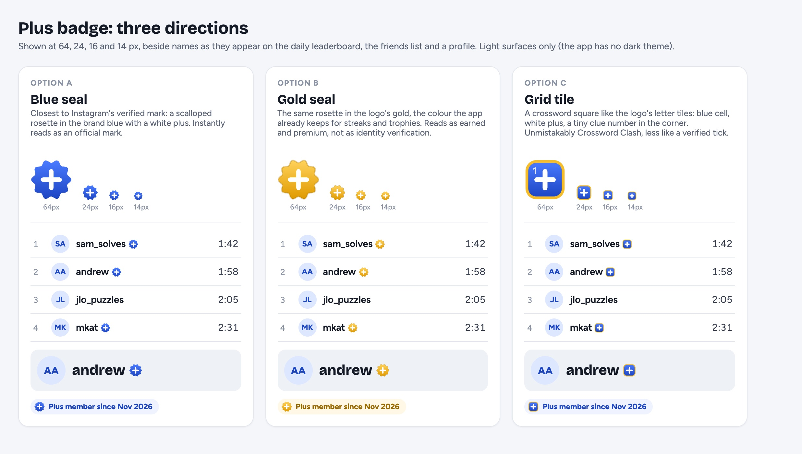

# Plus expansion: bonus puzzles, friend races, deeper stats, streak repair, the Plus badge

Written 2026-11-12. Spec only: no application code changes. Claims about the
current code cite a file (line numbers are from `main` at 4c70878); numbers not
read from the code are marked as estimates.

Context: Plus today ($3.99/month, $24.99/year, first month free) sells the
archive past 30 days, the studio, the AI host on the TV view and synced
progress (`plus.benefit*` in `src/i18n/en.json:734-737`). Andrew's read
(2026-11-12): someone who only solves has enough free puzzles never to need
Plus. This spec adds four features aimed at the daily solver (bonus puzzles,
friend races, deeper stats, streak repair) and a Plus badge that
makes membership visible. Host and league perks (team mode, larger leagues,
season history) are deferred: worth doing once rooms and leagues show use,
and the bigger lift.

The principle throughout: Plus **adds** to what free players do every day; it
takes nothing they have today away.

---

## Decisions

Decided by Andrew on 2026-11-12 (1–7); 8–10 and the racing details in §2.6
are still open.

| # | Decision | Status | Where |
|---|---|---|---|
| 1 | Bonus cadence and size | **Decided: an extra puzzle every day.** Size proposed: **11×11**, between the midi (9×9) and the large (15×15); 7×7 sits too close to the mini. Size still open | §1.1 |
| 2 | Free play of the bonus | **Decided: none.** Free players see the card only | §1.2 |
| 3 | Who may race your solve | **Decided: your accepted friends**, unless you turn off "Let friends race my solves" (default on) | §2.3 |
| 4 | Friend races free vs Plus | **Decided: every race is Plus.** Free keeps today's "beat my time" challenge link | §2.2 |
| 5 | Deeper stats free vs Plus | **Decided: the full page is Plus.** Free players see the real stat labels with blurred figures, so it reads as locked, not broken | §3.2 |
| 6 | Streak freeze | **Decided: not now** (repair covers it; revisit if lost streaks drive people away) | §4 |
| 7 | Streak repair | **Decided: Plus only, offered for 24 hours**: a missed day can be repaired until the end of the next day (local), by solving the missed day's daily. Free players see the offer and the Plus pitch | §4.2 |
| 8 | Badge design | **Open.** Recommendation: option B, the gold seal (Plus is already marked with gold, gold is the app's colour for earned things, and it won't read as identity verification). Option A, the blue seal, is the closest to Instagram's tick | §5.1 |
| 9 | Badge visibility | **Open.** Recommendation: on by default, with "Show my Plus badge" on the account page | §5.2 |
| 10 | Order | **Open.** Recommendation: badge → streak repair → bonus puzzles → stats → friend races | §7 |

---

## 0. What exists today (the code this builds on)

| Area | Today | Where |
|---|---|---|
| Daily feed | Static JSON per day and slot (`public/daily-puzzles/{day}.json`, `{midi,large}/{day}.json`), or the `daily_schedule` table through `api/daily.ts`; **fully public, solutions included**, `Access-Control-Allow-Origin: *` | `src/lib/dailyFeed.ts:78-84`, `vercel.json`, `proxy.ts:26-47` |
| Slots | `DAILY_SLOTS = ["mini","midi","large"]`, one puzzle per slot per day; a slot list is repeated in `api/daily.ts:20`, `proxy.ts:26`, `dailyIndex.ts:46`, `archive.ts:90`, `nextUp.ts:21`, vercel.json rewrites and SQL CHECKs | `src/lib/dailyFeed.ts:31-32`, `20261018000000_daily_midi_slot.sql:5-9` |
| Puzzle identity | djb2 hash of title + size + solution (`puzzleIdentity`), the key for best times, `solves`, `solo_progress`, `play_sessions` | `src/lib/soloStats.ts:128-134` |
| Plus checks | Client `plusEnabled()` + `usePlusStatus`; server `has_entitlement()` (SECURITY DEFINER), `PLUS_GATES=1`. Server-side gates exist only for metered AI (narrator, studio-claude) and the `solo_progress` RLS | `src/lib/plus.ts`, `supabase/functions/_shared/plusAccess.ts:16-43`, `20261024000000_entitlements.sql:114-131` |
| Archive lock | **UI only**: Play/Race are hidden for locked days, but the JSON is public and `/daily/:day/:slot` does not check the lock | `src/lib/archive.ts:52-68` |
| Streaks | Consecutive local days with a qualifying finish (`countsForDailyStreak`: any solo finish or a daily race); assisted (revealed) finishes don't count; accounts derive the streak from `solves` rows (`streakFromDays`); **no freeze or repair** | `src/lib/solveHistory.ts:106,128,142`, `src/lib/soloStats.ts:192-218,308-319` |
| Stats data | `solves` (owner-only; seconds, source, mode, day), `daily_results` (public; day, slot, seconds), `play_sessions.clues` (owner-only; per-clue first focus, solved at, wrong letters, order; blanked after 180 days; only sent in the apps or with analytics consent) | `20261017300000_solves.sql`, `20260701000000_daily_race.sql:16-51`, `src/lib/playInsights.ts:26-41` |
| Stats UI | Daily streak, NYT streak, solve count, recent solves with times; no history, averages or charts | `src/screens/AccountScreen.tsx:189-212,395-419` |
| Friends | `friendships` + `friend_solves(puzzle_key)` (who solved, never times or letters); the friends spec says friends see no streaks, times or activity, though daily times are public on the board, which has a friends filter | `20261101000000_friends.sql`, `20261104000000_friend_solves.sql:12-34`, `docs/friends-spec.md:160-162`, `src/screens/DailyLeaderboardScreen.tsx:169-181` |
| Ghosts | `challenge.ts` already races a challenger's **finish time** from URL params (`cf`/`ct`), and `?beat=&by=` on dailies; **no solve is recorded move by move anywhere** (rooms broadcast cells without timestamps) | `src/lib/challenge.ts:1-14,117`, `src/lib/dailyChallenge.ts:1-18`, `src/hooks/useMultiplayer.ts:591-640` |
| Names | `profiles.username` (public) for friends; free-text `display_name` copied into `players` and `daily_results` for rooms and the board; **no badge component** | `20261017100000_profiles.sql`, `src/components/Friends/PersonRow.tsx:37` |
| Plus status privacy | `entitlements` rows are owner-only, but `has_entitlement(p_user, …)` is granted to `authenticated`, so any session can ask about any user id | `20261024000000_entitlements.sql:60-62,114-131`, `20261104100000_rpc_anon_revoke.sql:13` |

---

## 1. Bonus puzzles

### 1.1 Product

An extra puzzle every day that only Plus can play: "Today's bonus" on the
menu beside the mini, midi and large, with its title, theme line and grid
shape (`MiniGridThumb`). It releases on the player's local day like the
dailies and stays playable for Plus forever; past bonuses get their own row
per day in the archive.

Proposed size **11×11** (decision 1): between the midi (9×9) and the large
(15×15), roughly a 5–8 minute solve (estimate). A 7×7 would sit too close to
the mini. Built with the same SeedGrid tooling as the midi and large and
reviewed by you as the dailies are; the real cost is **one more puzzle a day
to review**. Its difficulty can follow the large's weekday register.

### 1.2 Free versus Plus

**No free play** (decision 2). Free players see today's card (title, theme,
shape, "N solvers today") and the archive rows; Play opens the Plus pitch
(`paywall_viewed { placement: "bonus", feature: "bonus" }`, a new
`PlusFeature`).

### 1.3 Delivery: the bonus must not be a public file

The daily feed is public with its solutions (§0), and the archive lock is
only a hidden button. A bonus served the same way would be free to anyone
who reads the network tab. So bonuses live in the database:

```sql
create table bonus_puzzles (
  day       date primary key,          -- the day it publishes
  title     text not null,
  theme     text,
  author    text not null default 'Crossword Clash',
  width     int  not null,
  height    int  not null,
  blocks    text not null,             -- the grid shape only, for the card
  identity  text not null,             -- puzzleIdentity(), for solve history
  puzzle    jsonb not null,            -- the full transfer puzzle, answers included
  created_at timestamptz not null default now()
);
alter table bonus_puzzles enable row level security;
-- No select policy on the table itself: nobody reads `puzzle` directly.

-- The card: metadata for released days, for everyone.
create view bonus_cards as
  select day, title, theme, author, width, height, blocks, identity
  from bonus_puzzles where day <= (now() at time zone 'utc')::date + 1;

-- The puzzle: Plus only.
create function bonus_puzzle(p_day date) returns jsonb
  language sql security definer stable as $$
  select puzzle from bonus_puzzles
  where day = p_day and day <= (now() at time zone 'utc')::date + 1
    and has_entitlement(auth.uid(), 'plus');
$$;
```

Release uses the same "UTC date + 1" rule as the dailies (`proxy.ts:38-47`),
so a player ahead of UTC sees it on their own day. The client caches a
fetched bonus in localStorage so it plays offline afterwards.

**Publishing:** `pnpm bonus:add <day> <puzzle.ipuz> ["Theme"]` writes the row
with the service key (the way `daily:add` writes files), and the studio's
daily queue gains a "Bonus" lane for admins. The bonus never enters
`public/daily-puzzles/`, the index files or `proxy.ts`.

**Not a fourth slot.** Adding `bonus` to `DAILY_SLOTS` would touch a dozen
places that assume one puzzle per slot per day (§0) and would make it public
through `daily_schedule`'s "started days are public" policy. It is its own
small module (`src/lib/bonus.ts`) that the menu, archive and Up next read.

### 1.4 History, streaks and boards

- A bonus finish records a `solves` row with `source: 'bonus'` (extend the
  CHECK) and counts for the streak like any solo finish (§0).
- A bonus board reuses `daily_results` with `slot = 'bonus'` (extend its
  CHECK). Times are public as they are for the
  dailies; that is fine because the puzzle is not.
- Analytics: `bonus_viewed`, `bonus_started`, `bonus_completed`.

### 1.5 Effort (estimate)

3–5 days: migration and RPC, the `bonus:add` script, the menu card and
archive rows, the paywall placement, tests. Then one more puzzle a day
through the content pipeline and your review (the daily batch worktree
gains a bonus lane).

---

## 2. Friend races (racing a recorded solve)

### 2.1 Product

On any daily a friend has finished, "Race Sam's solve" starts the puzzle
with Sam's progress playing beside yours: their clock, a bar for how much of
the grid they've filled, and the squares they fill appearing as a soft tint
on your grid at the moment they filled them, **without their letters**. Beat
their time and the result card says so ("You beat Sam by 0:12"); the friend
gets a "Sam's solve was raced" notice through the existing invites table.

This is the async half of the roadmap's open F4 question (`ROADMAP.md:81-93,
125-126`) and an upgrade of `challenge.ts`, which already races a finish
time from a link.

Entry points (each opens the Plus pitch for a free player,
`paywall_viewed { placement: "race", feature: "race" }`):
- the friends filter on the daily board ("Race" beside each friend's time);
- the friend's "Solved" chip on a puzzle (`SolveChip`);
- the completion screen ("Race a friend's solve of this").

### 2.2 Free versus Plus

**Every race is Plus** (decision 4): a friend's solve on any daily, archive
day or bonus, your own best, and several friends at once. Free players keep
what exists today: the "beat my time" challenge link (`challenge.ts`,
`dailyChallenge.ts`), which races a finish time, not a recorded solve.

A free player's recorded solves are still raceable by their Plus friends
(recording costs nothing and a friend racing you is what makes you curious
about Plus).

### 2.3 Recording a solve

Nothing records a solve move by move today (§0), so this is the new part.

**What's recorded:** during a solo daily or bonus, append `[ms, cell, letter]`
for every letter written or erased, where `ms` is active time (the solo pause
already stops the clock). A 15×15 is roughly 200–400 events, about 2–4 KB as
compact JSON (estimate). Only finishes without reveals are kept, matching the
streak and board rules.

```sql
create table solve_traces (
  user_id     uuid not null references profiles(user_id) on delete cascade,
  puzzle_key  text not null,
  seconds     int  not null,
  events      jsonb not null,           -- [[ms, cell, letter], …]; letter '' for an erase
  created_at  timestamptz not null default now(),
  primary key (user_id, puzzle_key)     -- your best (fastest) solve replaces a slower one
);
alter table solve_traces enable row level security;
create policy "own traces" on solve_traces for all using (auth.uid() = user_id);
```

**Reading a friend's trace:** `friend_trace(p_friend uuid, p_puzzle_key text)`
(SECURITY DEFINER) returns `{seconds, events}` with the letters **stripped to
"filled" / "erased"** when the caller is an accepted, unblocked friend and
the friend's `race_my_solves` setting (a new `profiles` column, default
true, decision 3) is on, and the caller has Plus. The server strips the letters so a ghost can never be used to
cheat the board. The board's existing time rule is unaffected.

Retention: traces older than a year are deleted by `retention_sweep()`. Only
accounts record (the trace needs a profile), and the "Let friends race my
solves" setting lives on the account page next to the badge setting (§5.2).

### 2.4 Playing a ghost

A `useGhost(events)` hook advances an index by the player's own active
clock, paints the friend's filled cells into a `ghostCells` set the grid
draws as a tint below the player's letters, and shows the ghost's clock and
fill bar in the header. It pauses with the solo pause. On finish,
`compareToChallenge` (`challenge.ts:117`) produces the result.

### 2.5 Effort (estimate)

1.5–2 weeks: recording in `usePuzzle` / `SoloPlayScreen`, the table and RPC,
the ghost hook and grid tint, three entry points, the result card, the
setting, tests. This is the largest item here.

### 2.6 Open: how a race looks

Andrew wants input on the racing experience; these are the open choices,
with the current proposal first:

1. **What the ghost shows on your grid**: a faint tint on the squares the
   friend had filled by now (proposed); or nothing on the grid, only their
   clock and fill bar; or their cursor moving through the grid.
2. **A replay after you finish**: watch the friend's whole solve with
   letters, sped up. Safe because you've finished. Proposed: yes.
3. **Which solve you race**: the friend's fastest (proposed) or their first.
4. **How many ghosts at once**: up to 3 (proposed) or just 1.

---

## 3. Deeper stats

### 3.1 Product

A Stats page (from the account page, and the completion screen's "See your
stats") built from data already collected:

1. **Times over time** per slot: a line of your daily times with your
   average and best marked (`solves` + `daily_results`).
2. **By weekday**: average time per weekday and slot (the large is clued at
   an easy register Monday to Saturday and harder on Sunday,
   `docs/daily-large-queue.md:14`; this card shows how much that costs you).
3. **Where you rank**: on each daily, "faster than 82% of solvers", from the
   public `daily_results` for that day and slot.
4. **Head-to-head with friends**: wins and losses against each friend on the
   days you both solved (`daily_results` filtered to friends, as the board's
   friends filter already does).
5. **Slowest clues this month**: the clues that took you longest from first
   focus to solved, with the puzzle and your time on each
   (`play_sessions.clues`). Shown only when that data exists (the apps, or
   web with analytics consent), with a line saying so otherwise.
6. **A solved-days calendar** (a year heatmap), with repaired days marked
   (§4).

### 3.2 Free versus Plus

**The Stats page is Plus** (decision 5). The account page keeps what it shows
today (streak, count, recent solves). A free player who opens Stats sees
every card **with its real label and layout, the figures blurred**: "Faster
than ▒▒% of solvers", "Your average Saturday: ▒:▒▒", a chart line with its
axes and the line itself blurred. Nothing is empty or greyed, so it reads as
locked rather than broken. One "See your stats with Plus" button sits under
the first card (`paywall_viewed { placement: "stats", feature: "stats" }`).
The blurred figures are placeholders drawn on the client: the RPCs return
nothing to a free player (§3.3), so the blur hides no real data.

### 3.3 Server

- `my_stats(p_since date)`: one SECURITY INVOKER RPC returning the aggregates
  for cards 1, 2 and 6 from the caller's own `solves` and `daily_results`
  rows.
- `my_percentiles(p_since date)`: for each of the caller's daily results,
  the share of that day's results in the same slot that were slower, from
  `daily_results` (already public).
- `my_head_to_head()`: for each accepted friend, days both finished and the
  wins of each.
- `my_slow_clues(p_since date)`: the top 10 `play_sessions.clues` entries by
  `s - f`, owner-only by the existing RLS.

The Plus check is in the RPCs (`has_entitlement(auth.uid(), 'plus')`), not
only in the UI.

### 3.4 Effort (estimate)

4–6 days: four RPCs, the page with six cards (the dataviz rules in
`docs/DESIGN.md` and the existing tokens), the blurred free state, tests.

---

## 4. Streak repair

### 4.1 Today

A streak is consecutive local days with a qualifying finish; one missed day
resets it to zero (`effectiveStreak`, `soloStats.ts:218`; `streakFromDays`,
`solveHistory.ts:128`). Nothing protects or restores it.

Freezes (a banked day that covers a miss automatically) are **not in this
round** (decision 6): repair covers the common case and keeps you playing to
keep a streak. Revisit if lost streaks show up as a reason people leave.

### 4.2 Repair (Plus only)

- When a streak breaks, the missed day's dailies show **"Repair your
  streak"** in the archive and on the menu **for 24 hours: until the end of
  the next local day** (miss Tuesday, repair any time Wednesday). Solving one
  of them (no reveals) restores that day, and the streak carries on as if it
  never broke. After that the offer is gone and the streak stays broken.
- One repair per missed day. Because the window is a single day, only a
  one-day gap can be repaired: miss two days in a row and the first is out
  of reach by the time you return.
- **Free players** see the same prompt with what it would save ("Repair your
  23-day streak with Plus") and the pitch
  (`paywall_viewed { placement: "streak", feature: "streak" }`). The prompt
  appears the day the streak breaks, the moment it matters most.
- The menu confirms once: "Streak repaired: Tuesday counts again."

### 4.3 Data

A repair is a row, so the streak stays derived and syncs as it does now:

```sql
create table streak_repairs (
  user_id    uuid not null,
  day        date not null,             -- the missed day, now kept
  puzzle_key text not null,             -- the daily solved to repair it
  created_at timestamptz not null default now(),
  primary key (user_id, day)
);
```

- `streakFromDays` takes the union of solve days and repaired days.
- `repair_streak(p_day, p_puzzle_key)` is a SECURITY DEFINER RPC that checks
  `has_entitlement`, that the day was missed, that the caller's local today
  is the day after it (the client sends its day key, as `solves` already
  trusts; the server checks it is within a day of UTC now), and that the
  puzzle is that day's daily.
- The local streak (`crossword-clash-solo-stats`) applies the same repairs
  for a signed-out Plus session, so the number matches on every screen.

### 4.4 Effort (estimate)

2 days: the table and RPC, the streak function change on both paths, the
menu and archive prompts, the free-player pitch, tests.

---

## 5. The Plus badge

### 5.1 Design

A small seal after the name, like Instagram's verified tick. Three directions
are mocked up at real sizes beside leaderboard, friends and profile names in
`docs/plus-expansion/badge-options.jpg` (source:
`docs/plus-expansion/badge-options.html`):



- **A, blue seal**: a scalloped rosette in the brand blue with a white plus.
  The closest to Instagram, and the one most likely to be read as
  "verified".
- **B, gold seal (recommended)**: the same rosette in the logo's gold, with a
  thin darker rim so it holds on white. The Plus pitch, the account menu row
  and the Plus nudge already mark Plus with a gold sparkles tile
  (`PlusNudge.tsx:31-32`, `AccountMenuRow.tsx:43-44`), and `docs/DESIGN.md`
  keeps gold for earned things (streaks, trophies). It stands out on a
  leaderboard without competing with the blue action colour.
- **C, grid tile**: a blue crossword square with a gold rim. The most
  on-brand, but at 14 px it reads as a button more than a mark.

Component: `src/components/ui/PlusBadge.tsx`, an inline SVG sized in `em`
(default 0.95em) so it follows the name's type size, kept on the name's line
with the name inside one `whitespace-nowrap` span, 0.25em gap. Its props are
`size` and `interactive`. It has `role="img"` and `aria-label="Crossword Clash
Plus member"`.

**Tapping it** opens a small popover: "Crossword Clash Plus member", and for
a viewer without Plus, "Get Plus" (`paywall_viewed { placement: "badge" }`).
That makes every badge on a leaderboard a doorway to the pitch.

### 5.2 Data and privacy

- Add `profiles.plus_badge boolean not null default false`, kept by a
  SECURITY DEFINER trigger on `entitlements` (true while
  `has_entitlement(user_id, 'plus')`, and the owner's
  `profiles.show_plus_badge`, default true, is on). The nightly sweep
  re-derives it for entitlements that expire without a row change.
- `profiles` is already publicly readable, so every surface joins it by
  `user_id`.
- **Close the existing leak in the same migration**: restrict
  `has_entitlement(p_user, …)` so a non-service caller may ask only about
  `auth.uid()`. Otherwise someone who turned the badge off can still be
  looked up.

### 5.3 Where it appears

| Surface | Name source today | Change |
|---|---|---|
| Daily board | `daily_results.display_name` (`DailyLeaderboardScreen.tsx:488`) | join `profiles.plus_badge` on `user_id` in `fetchDailyLeaderboard` |
| Friends, requests, invites, race suggestions | `PersonRow` (`PersonRow.tsx:37`) | add `plus_badge` to the profile fetches in `src/lib/friends.ts:298,394-398` |
| Lobby, in-race scoreboard, results | presence `display_name` (`GameLobby.tsx:205`, `MultiplayerScoreboard.tsx:70`, `CompletionModal.tsx:455,488`) | add `plus` to the presence payload from the client's own status (low stakes if spoofed), confirmed from `profiles` where a `user_id` is known |
| Account header and page | `AccountControl.tsx:92-93` | own status |
| Community "by @author" | `CommunityList`, `Reports.tsx:115` | join on author |
| TV views | `HostLobbyScreen.tsx:109`, `TVScoreboard.tsx:64`, `SpectatorScreen.tsx:95` | phase 2 (the stage colours need their own check) |

Share text and result cards stay plain text: no badge.

### 5.4 Effort (estimate)

2–3 days: the component and popover, the migration (column, trigger, setting,
`has_entitlement` restriction), six surfaces, the account setting, tests.

---

## 6. Gaps found while writing this (outside the five features)

1. **The archive lock is only UI.** Older dailies are public files and
   `/daily/:day/:slot` plays any released day without checking the window
   (`src/lib/archive.ts:52-68`, §0). Shared links rely on that, so fixing it
   means a server-side feed for archive days. Not needed for this spec, but
   the archive is a weaker Plus line than it looks.
2. **The feed index lists future days** (titles, themes, shapes, identities;
   no answers), because `proxy.ts`'s `FEED_PATH` covers day files only
   (`proxy.ts:26`).
3. **Reveals have no free/Plus limit in code.** `docs/monetization-spec.md`
   decision 7 plans "free 1 per puzzle, Plus unlimited"; the reveal button
   (`SoloPlayScreen.tsx:631`) has no counter. Nothing in the pitch promises
   it, so nothing is broken, but it is unbuilt.
4. **`has_entitlement` answers for any user id** (§5.2): fix it with the badge.
5. `gold-800` is used at `src/components/Studio/Reports.tsx:119` but isn't a
   theme token.

---

## 7. Order and the pitch

| Step | Feature | Effort (estimate) | Why this place |
|---|---|---|---|
| 1 | Plus badge | 2–3 days | Smallest; makes Plus visible on every board; fixes the status leak |
| 2 | Streak repair | 2 days | Small; protects the daily habit, Plus's most emotional hook |
| 3 | Bonus puzzles | 3–5 days + a puzzle a day to review | Recurring new content, the strongest reason to stay subscribed |
| 4 | Deeper stats | 4–6 days | Uses data already collected; the blurred free state sells it |
| 5 | Friend races | 1.5–2 weeks | Needs the new recording, and the open choices in §2.6 |

When each ships, the Plus pitch (`PlusPitch.tsx`, `plus.benefit*`) gains a
line. The intended final list, most compelling first:

- An extra bonus puzzle every day
- Race your friends' solves, and your own best
- Your full stats: trends, ranks, head-to-heads
- Repair a broken streak
- Every daily since the archive began
- The Plus badge
- Build your own crosswords in the studio
- The AI game-show host on the TV view
- Half-finished puzzles follow you to every device

**Measuring:** each feature adds a `paywall_viewed` placement (`bonus`,
`race`, `stats`, `streak`, `badge`). Comparing placements by views and by
`purchase_completed` shows which features are actually selling Plus, and
what to build next.
